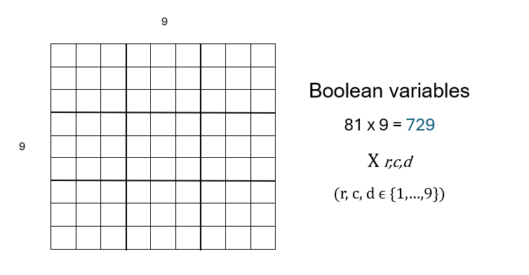
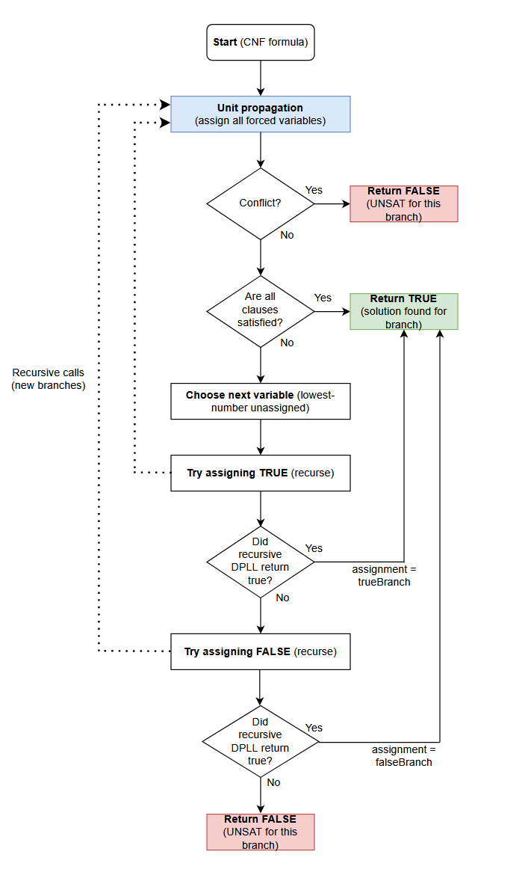
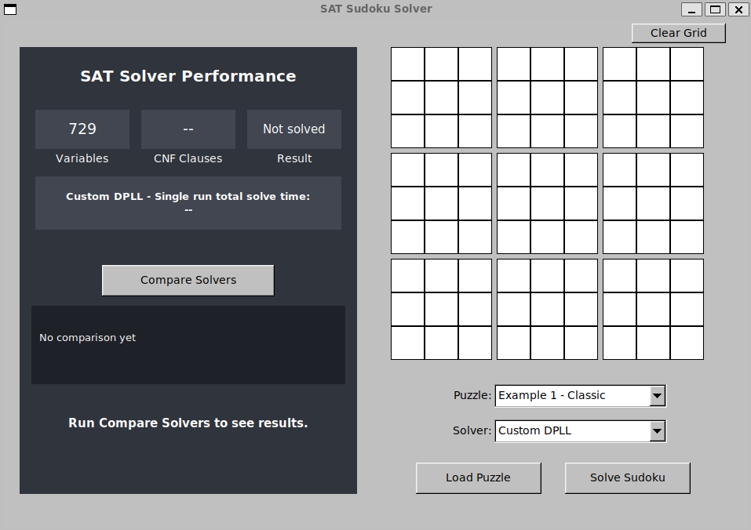
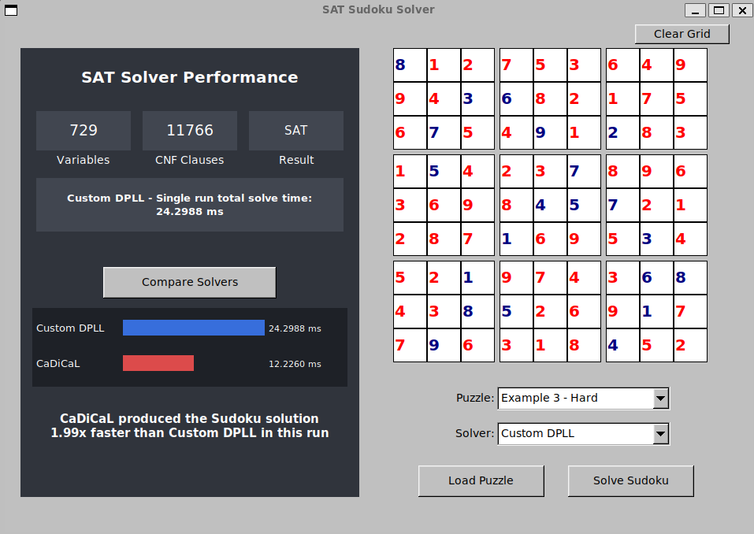

# Sudoku SAT Solver

## Overview

For this project, I developed a Sudoku solver in C++ using Boolean Satisfiability (SAT).

The program converts a 9x9 Sudoku puzzle into a Conjunctive Normal Form (CNF) formula, which can then be solved using either my own implementation of the DPLL algorithm or the CaDiCaL SAT solver.

I also created a graphical interface using FLTK, allowing users to enter Sudoku puzzles, load example puzzles and compare the performance of both solvers.

The main aim of the project was to understand how SAT solving works and investigate how my own DPLL implementation compares against an established SAT solver.

There are simpler and faster ways to solve Sudoku, but my project focuses on converting Sudoku into a SAT problem and solving it using my own DPLL algorithm.

Generality is one of the main advantages of this project, as my DPLL solver can solve other problems as long as they are converted into CNF.

## Features

- Custom DPLL SAT solver implemented in C++.
- Sudoku to CNF conversion using 729 Boolean variables.
- Integration with the CaDiCaL SAT solver.
- Graphical interface built using FLTK.
- Ten example Sudoku puzzles and support for manual input.
- Displays completed Sudoku grids and solver execution times.
- Performance comparison between DPLL and CaDiCaL.
- Automated correctness tests and a separate benchmarking program.

## How It Works

### Sudoku to CNF

Each possible combination of a row, column and digit is represented by a Boolean variable.

A standard 9x9 Sudoku grid contains 81 cells, each with 9 possible digits, giving a total of 729 variables.



The CNF formula contains clauses that enforce the Sudoku rules:

- Each cell must contain exactly one digit.
- Each digit can appear only once in each row.
- Each digit can appear only once in each column.
- Each digit can appear only once in each 3x3 box.
- Numbers already given in the puzzle must remain fixed.

Once the formula has been solved, the satisfying assignment is converted back into a completed Sudoku grid.

### Custom DPLL Solver

I implemented the Davis-Putnam-Logemann-Loveland (DPLL) algorithm using recursion and backtracking.

The solver first uses unit propagation to make any forced assignments. If the formula is not yet solved, it selects the lowest numbered unassigned variable and tries assigning it true.

If this causes a contradiction, the solver backtracks and tries false instead.

This process continues until a satisfying assignment is found or the formula is determined to be unsatisfiable.

The flowchart I have created below demonstrates this logic, with the dotted lines representing the recursive calls and branches.



### CaDiCaL

I integrated CaDiCaL as a second SAT solver to compare against my DPLL implementation.

CaDiCaL uses more advanced techniques, including Conflict-Driven Clause Learning (CDCL), which allows it to learn from conflicts during the solving process.

Comparing the two solvers helped me investigate the difference between a basic DPLL implementation and a more optimised SAT solver.

## Graphical Interface

The GUI was developed using FLTK.

Users can select an example puzzle or enter their own numbers into the Sudoku grid. They can then choose which solver to use.

After solving, the interface displays the completed Sudoku alongside information such as the number of CNF clauses, number of variables, SAT result and execution time.

Note: the execution time on the GUI measures the time taken to solve a Sudoku once, including CNF generation, solver setup, solving and decoding.

There is also a comparison feature which runs both solvers and displays their execution times in a bar chart.

## Testing

I wrote automated tests to check that both solvers work correctly.

These tests cover solving valid Sudoku puzzles, checking completed grids against Sudoku rules and detecting puzzles with contradictory clues.

## Benchmarking

I benchmarked my DPLL implementation against CaDiCaL using six Sudoku puzzles, running each solver 100 times per puzzle.

I measured both solver call time and end to end execution time. Solver call time measures the SAT solving operation itself, while end to end time also includes solver initialisation and clause loading where applicable. Unlike the GUI execution time measurement, the benchmarks exclude CNF generation and Sudoku decoding.

CaDiCaL achieved faster solver call times on all six puzzles. However, my DPLL implementation had lower end to end times on four of them because it required less setup.

On the two harder puzzles, CaDiCaL's faster solving performance outweighed its setup overhead.

These results show the difference between SAT solving performance and the practical execution time of the implementations.

The full results and analysis can be found in [Benchmark Results](benchmark_results.md).

## Requirements

- C++17
- g++
- FLTK
- [CaDiCaL SAT Solver](https://github.com/arminbiere/cadical)
- Linux or WSL/Ubuntu

## Building and Running

This project was developed and tested on Ubuntu using WSL.

FLTK must be installed and CaDiCaL must be built locally before compiling the application.

For instructions on how to download and build CaDiCaL locally visit the official CaDiCaL repository.

The commands below assume CaDiCaL is located at `$HOME/cadical`.

### Compile the GUI

```bash
g++ -std=c++17 -O2 -Wall -Wextra \
    -I$HOME/cadical/src \
    gui.cpp sudoku.cpp dpll.cpp cadical_solver.cpp \
    $HOME/cadical/build/libcadical.a \
    $(fltk-config --cxxflags --ldflags) \
    -o sudoku_gui
```

### Run the GUI

```bash
./sudoku_gui
```

## Project Files

| File | Purpose |
|---|---|
| `dpll.cpp` / `dpll.hpp` | Custom DPLL solver |
| `sudoku.cpp` / `sudoku.hpp` | Sudoku CNF encoding and decoding |
| `cadical_solver.cpp` / `cadical_solver.hpp` | CaDiCaL integration |
| `gui.cpp` | FLTK graphical interface |
| `tests.cpp` | Automated correctness tests |
| `benchmark.cpp` | Solver performance benchmarks |
| `benchmark_results.md` | Benchmark results and analysis |

## Limitations and Future Improvements

My DPLL solver uses a basic variable selection method, which can lead to unnecessary searching and backtracking on harder puzzles.

One possible improvement would be to implement a better variable selection heuristic and measure how it affects performance.

I could also test a larger number of Sudoku puzzles and record the number of decisions and backtracks made by my solver to better understand its behaviour.

## Screenshots

### Sudoku Solver GUI



### Sudoku Solver GUI in use

